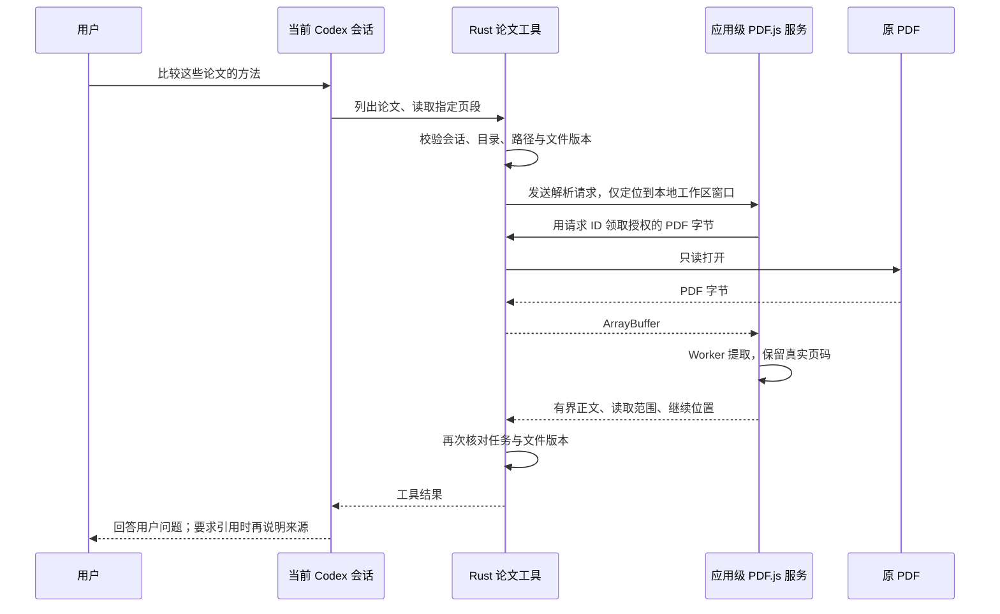

# 论文读取服务技术方案

日期：2026-10-17。状态：已实现，验证记录见文末。本文件作为该功能的实现规格；此前[问题定位与修复规划](论文读取中间文件污染-定位与修复方案-2026-10-17.md)保留执行证据，涉及取舍时以本文件为准。按用户最新要求，默认回答集中于问题，仅主动要求引用时说明来源或页码。

## 1. 确定的技术路线

保留现有 Codex app-server 和全局 AI 入口，向文献会话增加三个宿主工具：论文清单、按页读取、文内搜索。Rust 负责会话与路径授权、读取原始字节和结果归属；应用级 PDF.js 服务负责提取。正文通过已有工具回传协议交给原 thread，不经由文献目录中的 TXT。

沿用 Tauri 2、Rust、React/TypeScript、`pdfjs-dist` 和现有 Worker/字体资源。不增加 Python 服务、第二个 Agent、全文索引或向量数据库。本批只实现内存解析缓存，不实现磁盘全文缓存。



解析任务没有文献目录写入步骤。数据流仍是当前 Agent 的工具调用与结果回传，不新增一次独立模型请求。

## 2. 解决的问题与对应设计

| 当前问题 | 确定设计 | 用户可见结果 |
| --- | --- | --- |
| 阅读时把全文转换为相邻 TXT | 只读读取 PDF，PDF.js 直接返回逐页文字 | 文献目录不因标准阅读流程新增中间文件 |
| 只拿到当前页，其他论文依赖 shell | 工具可读取目录内尚未打开的 PDF | 不必逐篇打开或拖入，就能请求多篇概览 |
| 已打开论文索引不能代表所有文件 | 清单扫描实际 PDF，读取不创建绑定 | 新放入目录的论文也可发现，不依赖已有 paper ID |
| 附件前 20 页限制不适合长文分析 | Agent 使用页段与字符偏移继续读取 | 可以读取后段和附录，不把截断冒充全文 |
| 中间 TXT 可能成为过期上下文 | 以原 PDF 字节版本校验解析结果 | PDF 变动后重读，旧结果不会被标为新内容 |
| 侧栏关闭或切页影响前端处理 | 解析服务归工作区窗口生命周期 | 阅读不抢焦点；隐藏侧栏不销毁正在处理的任务 |
| 多会话可能返回错材料 | 请求绑定项目、根目录、会话、thread、turn、窗口 | 并行读取同名论文也不会串结果 |
| 回答夹带过多读取说明 | 实际页码留在工具结果，默认不附来源卡片或页码清单 | 回答集中于用户问题；需要时可追问依据 |

## 3. 三个工具的具体接口

工具只在新的文献 Agent thread 注册，复用 [tools.rs](../../src-tauri/src/agent/tools.rs) 的 `dynamicTools` 与工具回传。模型不能指定另一个项目、窗口、绝对目录或数据路径。

### 3.1 `scientify_list_papers`

输入：可选相对子目录、分页位置。每批返回最多 100 个 PDF，复用现有目录条目格式，包含相对路径、文件名和字节大小。此只读扫描不绑定 paper ID。排序稳定，并返回继续位置及清单是否完整。

复用文献目录遍历和已有总量限制，以实际文件为准；不能只列 `.scientify/library.json` 中已打开过的绑定。文件较多时以有界的只读清单快照分页，快照过期或根目录改变则要求重新列举，不用数组下标假装在变化中的目录上实现稳定分页。不会创建笔记、注册新论文或修改索引。

### 3.2 `scientify_read_paper`

输入：相对路径、起始页（从 1 开始）、可选页内字符偏移、页数、可选预期文档版本。单次最多 8 页、24,000 字符。返回总页数、实际页段、逐页正文、版本、截断信息和下一次读取位置。

字符上限若在一页中间触发，继续位置包含该页和字符偏移，不能直接跳到下一页导致正文遗漏。后续读取携带第一次返回的版本；版本不同返回可识别的 `document_changed`，不在同一份分析中默默混用两个版本。

初始返回结构示意：

```json
{
  "path": "Vinci2.pdf",
  "version": "<读取字节的 SHA-256>",
  "totalPages": 36,
  "pages": [{ "page": 1, "startOffset": 0, "text": "...", "truncated": false }],
  "truncated": true,
  "nextCursor": { "page": 2, "offset": 0 }
}
```

### 3.3 `scientify_search_paper`

输入：相对路径、查询文字、可选起始页和预期版本。首批做大小写不敏感的普通文字匹配，不提供模型生成的正则或可执行查询。

每次最多扫描 20 页、返回 20 个匹配，每项摘录最多 500 字符；返回真实页码、已搜索范围、继续位置和搜索是否完成。若匹配数量上限在页内触发，继续位置也包含偏移。按页检查 5 秒处理预算，整个请求另有 30 秒截止时间；命中上限或预算时返回有界部分结果，不声称已搜索全文。明确区分“已搜索范围未找到”和“整篇未找到”。

## 4. 模块职责与请求通道

### 4.1 Rust：文件与任务归属

在 `src-tauri/src/agent/papers.rs` 实现工具服务及待处理请求表。在 [LocalLibrary](../../crates/scientify-core/src/library.rs) 内增加只读清单和按相对路径读取字节的入口，复用既有目录解析、符号链接拒绝、文件大小和 PDF 头校验。

读取时核对文献当前挂载根目录与会话的原生绑定相同；不能因为项目文献目录后来变更而把旧会话静默指向新目录。相对路径是唯一文件输入，且禁止遍历应用私有目录。即使选择完全允许，这三个宿主工具仍只服务于它们所属的文献目录；通用命令的权限定义不变。

待处理项记录随机请求 ID、原生窗口归属、项目、会话、thread、turn、规范路径、操作参数、文档版本和截止时间。它只是短期工具任务状态，不是第二套聊天会话或长期记忆。

### 4.2 前端：应用级解析服务

在 `src/reader/pdf-text.ts` 整理已有 PDF.js 配置、逐页提取与销毁逻辑；[附件读取](../../src/features/assistant/attachments.ts) 复用它并继续维持既有 20 MiB / 前 20 页 / 12,000 字符限制和附件数据格式。

在 `src/platform/paper-service.ts` 实现本地请求桥接，由 [App](../../src/app/App.tsx) 的工作区窗口分支注册一次。服务独立于 `AssistantPanel` 和 `PdfReader` 的挂载状态，不访问阅读页 DOM，不改变当前标签。

本次 Agent 自动读取上限确定为单份 50 MiB；现有人工阅读器的 150 MiB 上限不变。超出时明确告知 AI 提取限制，不能回退到在目录旁转 TXT。

### 4.3 通信与取消

采用 Tauri 定向事件加可信 IPC：服务完成监听注册后通过 ready 握手告知原生；原生仅在服务就绪后发出解析请求。服务未准备好返回明确可重试错误，不无限等待，也不自动转 shell。

前端通过 `agent_paper_source(requestId)` 领取原生已经授权的字节，通过 `agent_paper_complete(requestId, result)` 回传文字或明确错误。模型没有调用这些桥接 IPC 的入口。请求参数来自原生待处理项，前端领取字节时不能自行改路径、页段或项目。接口在 `build.rs`、`lib.rs` 和本地 capability 中登记，沿用 `main` / `workspace` 可信 WebView 校验，并额外匹配请求实际所属窗口。

使用已有 ArrayBuffer 响应传字节，不把 PDF 转成 base64 放进模型上下文。原生等待解析时释放会话锁；中止 turn 时取消对应待处理项，前端取消解析，无其他等待者时销毁对应 Worker。迟到结果返回“请求已取消或失效”，不能回复已经结束的 turn。关闭整个工作区窗口依旧遵守现有任务和保存保护。

## 5. 缓存、存储与资源上限

首批不保存独立全文缓存。每个工作区窗口最多同时解析 2 份 PDF，待处理队列上限为 8；超过上限返回可重试忙碌状态，不阻塞按钮和输入框。文本缓存采用最近使用淘汰，总计最多 16 MiB；单份页面解析对象空闲 30 秒释放，活动请求持有期间不淘汰。同一份论文的相同读取请求合并，取消一个调用方不取消其他调用方仍需要的共享解析。

缓存键为项目 + 规范文献根目录 + 相对路径 + PDF 内容 SHA-256 + 解析配置版本。原生读取快照前后检查文件属性，使用实际读取字节计算版本；文件监听失效现有指纹缓存，读取及回传前再次检查文件状态。严格版本针对本轮字节快照；不能承诺检测用户刻意保留修改时间并并发重写文件等所有外部文件系统竞态。重命名按新路径读取，删除文件后原生拒绝后续请求，旧解析对象及关联文字按空闲期限释放；新版本不能复用旧版本正文。

| 内容 | 位置及生命周期 |
| --- | --- |
| 原 PDF、用户主动保存的笔记/导出 | 用户原文献目录或明确指定位置 |
| PDF 解析对象、逐页文字缓存 | 应用内存；按上限、空闲时间及窗口退出释放 |
| 已进入模型对话的正文摘录与回答 | 沿用当前应用数据目录中的会话记录和 Codex 日志 |
| 用户明确要求、现有工具不支持而必须转换的中间产物 | 当前数据容器的 `tmp/agent/<项目>/<会话>/<任务>/` |

“内存解析”指不生成独立提取全文文件，并不表示发给模型的正文从不写入会话历史。对话仍按用户配置发送给模型服务商；本方案不新增全文上传、后台全库读取或额外模型服务。

宿主为每个 turn 创建独立临时目录及归属标记，在本轮执行说明中给出；常规 PDF 阅读不往该目录写提取文字，也不往文献目录写中间文件。确需中间产物的命令显式把输出写入临时目录。不依赖给已经运行的 Codex 进程逐轮修改环境变量，不把 shell 的当前目录改离原会话根目录，也不修改用户全局 TEMP。询问模式仅把当前任务临时路径补入可写范围，不开放整个数据容器。任务结束清理该任务的可丢弃中间文件，启动时清理超过 24 小时的自有残留；不能清理用户指定导出或可恢复隔离区。临时存储跟随现有数据位置设置迁移，不固定到 C 盘。

## 6. Agent 行为、权限与兼容

文献会话的宿主指令明确：阅读、比较、查找优先使用论文工具；不因读取任务在文献目录创建提取文本、临时脚本或图片；技能示例不等于用户要求导出。工具解析失败时说明失败类型和已读取范围，停止自动转换尝试；不安装新依赖、不通过 shell 偷偷绕过失败。

保留询问/完全允许两个选项和同一执行代理。论文工具本身可验证地只读；明确要求编辑、下载、移动、删除或导出的任务仍走现有工具及权限。完全允许下任意 shell 仍可写文件，因此本方案不能承诺系统级禁止所有越过论文工具的写入。用户标准论文任务必须通过真实供应商人工验收工具选择，仅靠夹具模拟不能宣称模型行为可靠。

本批确定不依赖给已创建的 Codex thread 热补工具：新文献会话注册论文工具，原生绑定增加可选 `paper_tools` 能力标记，旧数据默认不可用。旧会话历史、目录及权限保持，界面明确提示“此会话尚未启用论文工具”，提供同目录新建会话入口。用户点击后创建一个可见的新会话；不自动复制整段历史、不静默替换原 thread。以后若固定版本协议验证支持无损升级，可另行优化；不作为本批交付的前提。

## 7. 最终产品效果

用户仍只面对一个 AI 助手。例如输入“概览这个目录里的四篇论文，比较各自方法”，Agent 列出实际论文，按需读取摘要、方法、实验和附录，再在当前对话回答。并不承诺每个概览任务都逐字读取全文；工具记录真实读取范围，回答不夹带不必要的页码或读取日志。

复用现有工具执行状态和旋转指示，不添加单独的来源 UI。多会话各自保留任务状态，关闭侧栏和切换阅读页面不会终止解析。标准阅读后，左侧文献树只显示原有文件。

成功工具结果包含实际完成的页段与版本，沿用当前 Codex 工具历史。不增加 `paperSources` 字段或自动引用卡片，不改变消息保存格式。用户明确要求引用时，模型可依据本轮真实工具结果说明文件及页码；未读到的内容不得冒充已读。

用户要求“把总结保存为论文笔记”时，只保存所要求的笔记并遵守草稿/版本冲突保护；要求“导出全文 TXT”时才创建导出。用户自行放入的 TXT 和其他格式继续正常显示与阅读。

扫描件没有文本层、加密、损坏及无法正确还原的表格/公式须明确提示。首批不交付 OCR、公式结构恢复或精确表格抽取；可继续使用已有图片输入讨论用户主动提供的页面截图，不能把文本提取说成已经理解了全部版面。

## 8. 交付与验收门槛

按同一个完整功能批次交付共享提取模块、原生只读接口与桥接、三个工具、取消与版本处理、旧会话提示。临时目录规则一并落实，常规论文阅读不需提取中间文件。不得只交付一段提示词修改。

| 验收场景 | 必须达到的结果 |
| --- | --- |
| 概览 4 篇生成的 PDF | 工具真实列举并读取；任务前后源目录文件清单及原文件哈希一致 |
| 30 页以上文档，后段放入特定文字 | 能继续读取并搜索到后段，超长单页继续读取不丢文字 |
| 两项目同名论文，并行会话 | 来源、缓存、请求与回答不串；停止一个不影响另一个 |
| PDF 未打开，切换页面或隐藏侧栏 | 解析继续；不打开临时标签、不抢焦点、不锁输入框 |
| 删除/替换文件、Worker 错误、超时、中止 | 明确错误或实际部分结果；不把旧内容标成新结果、不写 TXT 兜底 |
| 远程网页、伪造请求、路径穿越、跨窗口回传 | 原生拒绝，不能读取未经当前请求授权的字节 |
| 显式导出、保存笔记、合法 TXT | 原有能力可用；草稿及冲突保护保留 |
| 旧会话与重启 | 历史可查，能力提示准确，可同目录新建会话 |

先用固定 Codex 版本和本机 Responses 夹具验证协议与无写入链路，再用真实供应商分别验收询问与完全允许下的论文任务。执行现有类型、格式、Vitest、Clippy、Rust、浏览器 UI 检查及 Release 构建。

现有 4 个 TXT 已按用户授权清理：逐字节核对原提取输出（包含 Windows 换行）后移入应用数据目录的可恢复隔离区，记录原路径、文件大小、SHA-256 和时间。未按后缀或同名规则批量删除其他文件，原 PDF 和笔记保持。恢复位置记录于本地隔离区清单，不把用户正文或对话日志加入仓库。

## 9. 实施验证记录

| 检查 | 结果 |
| --- | --- |
| `pnpm check`、`pnpm format:check` | 通过 |
| `pnpm exec vitest run --maxWorkers=2 --testTimeout=15000` | 51 个文件、286 项通过；随后补充同目录新会话回归，定向重跑所在文件 31 项通过，当前共验证 287 项不同测试 |
| `cargo fmt --all --check`、`cargo clippy --workspace --all-targets --locked -- -D warnings` | 通过 |
| `cargo test --workspace --locked -- --test-threads=2` | 135 项通过；1 个沙箱子进程测试入口按原设计忽略 |
| `node scripts/verify-ui.mjs reader assistant` | 阅读器/输入框/论文解析 54 项、AI 侧栏 12 项通过 |
| `node node_modules/@tauri-apps/cli/tauri.js build --no-bundle -- --locked` | Release 构建通过 |
| Git 差异空白检查、两份论文读取文档链接 | 通过 |

新增的 [核心文件读取测试](../../crates/scientify-core/tests/library.rs) 验证未打开 PDF 的只读访问、无绑定/笔记/文本生成、私有路径及越界拒绝、根目录变化与文件替换。原生论文工具测试覆盖生成的 IPC ACL、窗口归属、真实字节、失效结果、清单分页和取消；固定 Codex 0.158.0 搭配本机 Responses 夹具完成三个工具的实际调用及结果回传，验证源文件与目录清单未变化。

[提取测试](../../src/reader/pdf-text.test.ts) 与[服务测试](../../src/platform/paper-service.test.ts) 覆盖超长页续读不丢字、Unicode 边界、搜索匹配续读、共享读取取消、加载失败重试、队列及超时释放。浏览器验收用内存生成的 36 页 PDF 和真实 Worker，验证第 31 页搜索、未打开的后段读取、跨根目录同名文件隔离及页面响应。

测试只使用生成数据和临时文件，不调用用户模型密钥。夹具验证工具链路，真实供应商是否按指令选择工具仍需人工验收。

产物为 `target/release/scientify.exe`，生成时间 **2026-10-17 16:37:36 +08:00**，大小 **17,795,584 字节**。没有重新打包安装器。`Scientify-MVP.cmd` 会选择此最新 Release；没有关闭用户运行的旧版窗口。

人工验收：保存并手动关闭旧版应用，从 `Scientify-MVP.cmd` 打开新版，在文献目录新建会话，输入“概览这个目录里的论文并比较方法”。确认能回答且目录不再出现提取 TXT；默认回答不附页码来源清单。随后主动要求“列出对应页码”，应按实际工具结果回答。旧会话可从提示中的按钮在原目录新建，历史保留。用两会话并行任务和中止键检查取消与草稿交互。
